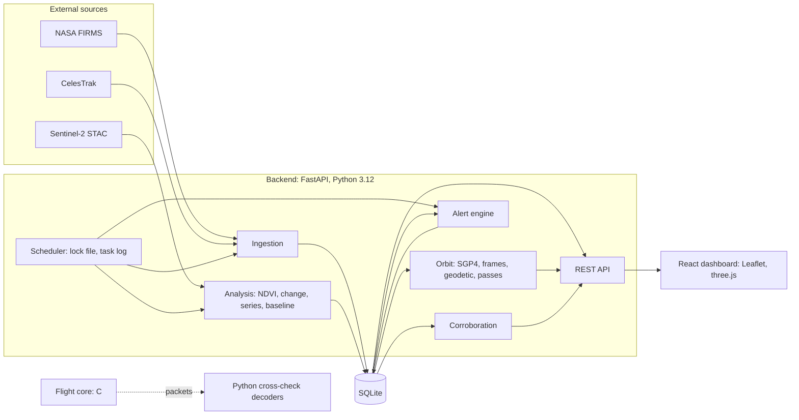
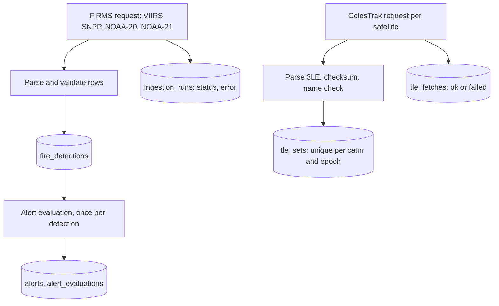
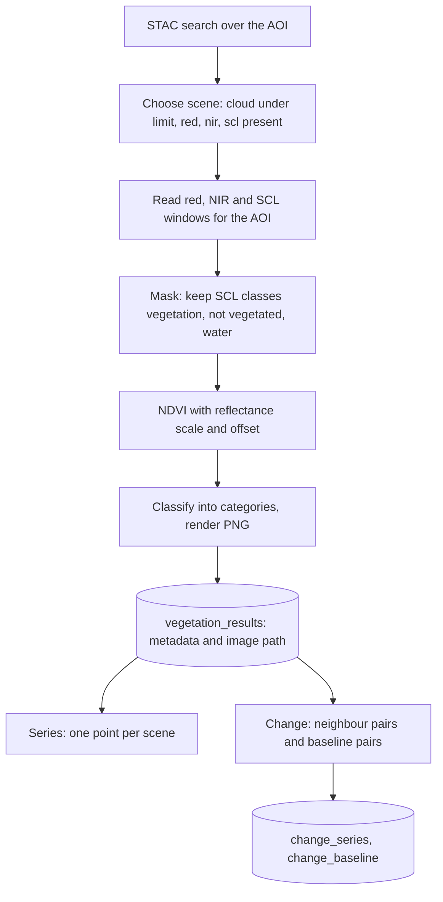
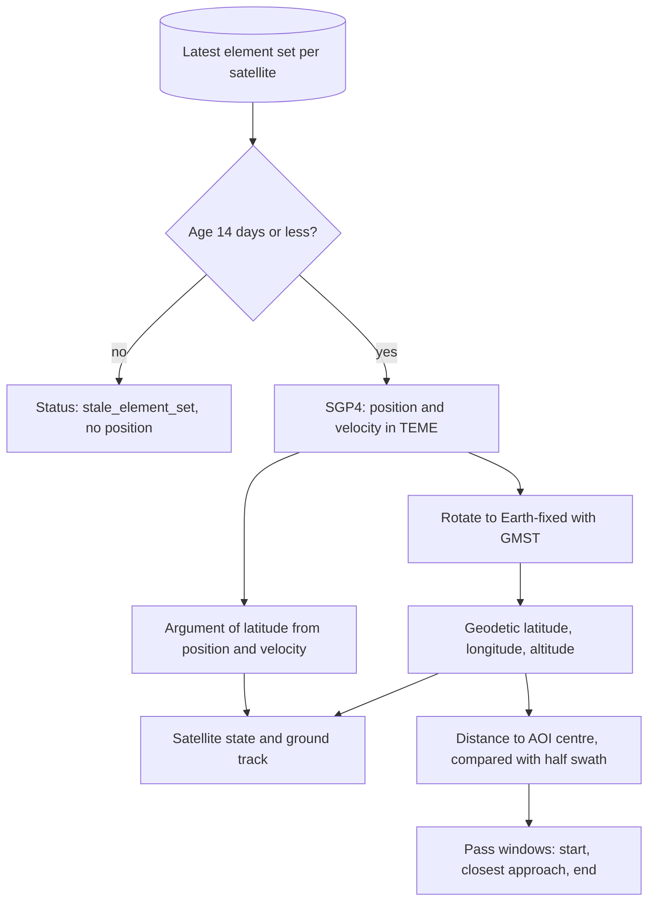
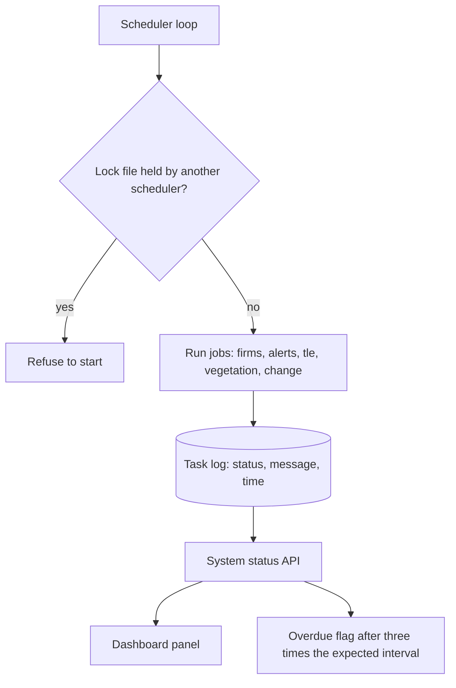
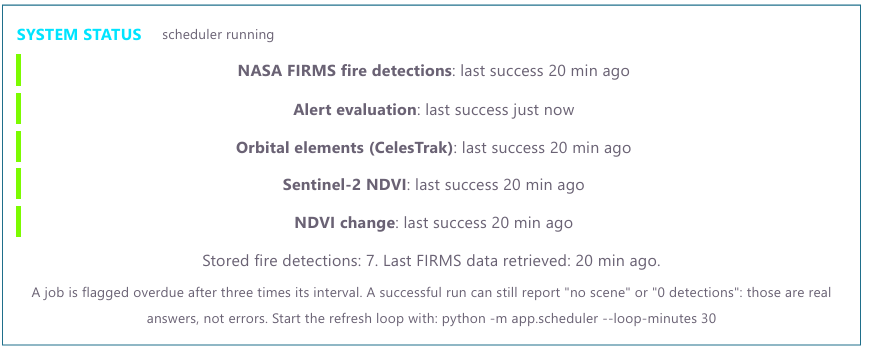
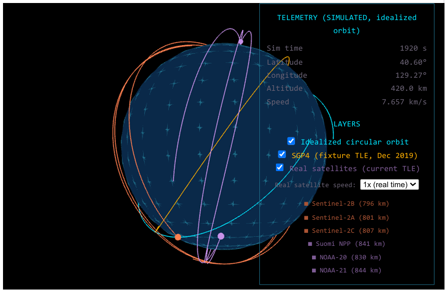
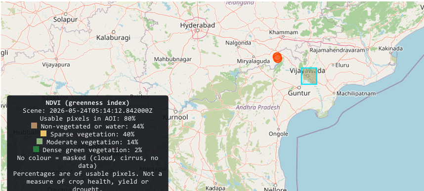
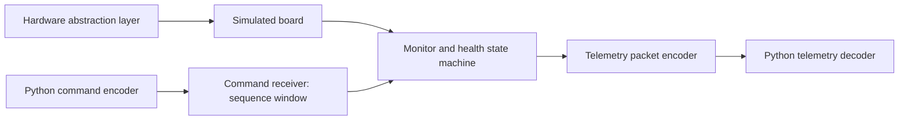

<a id="top"></a>


<div align="center">
  
  
</div>


<div align="center">

# ORBITAL EYE

**Earth Observation. Orbital Intelligence. Engineering Precision.**

A laptop-scale platform that connects orbital mechanics, satellite data pipelines, environmental monitoring and flight-software prototypes in one verifiable system.


 

[Overview](#overview) · [Architecture](#system-architecture) · [Dashboard](#dashboard) · [Results](#sample-results) · [Flight Core](#flight-core) · [Installation](#installation) · [API](#api-reference) · [Testing](#testing) · [Roadmap](#roadmap)

</div>

---

## Table of Contents

1. [Overview](#overview)
2. [System Architecture](#system-architecture)
3. [Orbital Mechanics](#orbital-mechanics)
4. [Satellite Intelligence](#satellite-intelligence)
5. [Dashboard](#dashboard)
6. [Sample Results](#sample-results)
7. [Environmental Monitoring](#environmental-monitoring)
8. [Technology Stack](#technology-stack)
9. [Data Architecture](#data-architecture)
10. [Flight Core](#flight-core)
11. [Project Structure](#project-structure)
12. [Installation](#installation)
13. [API Reference](#api-reference)
14. [Testing](#testing)
15. [Roadmap](#roadmap)
16. [Contributing](#contributing)
17. [License](#license)

---

## Overview

ORBITAL EYE follows the full chain from orbit to decision for one area of interest (AOI) around Vijayawada, India.

| Question | Subsystem |
|---|---|
| Where is each satellite, and when can it see the area? | SGP4 propagation from real CelesTrak element sets, pass prediction |
| What did it observe? | NASA FIRMS thermal anomalies, Sentinel-2 L2A imagery |
| How far can the observation be trusted? | Alert rules, multi-satellite corroboration, cloud masking, overlap checks |
| Is the system producing it healthy? | Scheduler, task log, system status panel |
| Could onboard software do this work? | C flight-core prototypes verified against independent Python decoders |

### Engineering principles

- **Provenance on every response.** Each API reply is labelled `REAL_EXTERNAL`, `PROPAGATED_FROM_REAL_TLE` or `SIMULATED`. The dashboard repeats the label on every panel, and simulated data is never mixed with real data.
- **No substitution.** A failed run or a "no scene" result is stored as such. Older or invented data is never used in its place.
- **Calibrated claims.** A thermal anomaly is never called a confirmed fire. Pass predictions are geometric, not guarantees of data. NDVI change is a pattern, not a diagnosis.

> **Status.** ORBITAL EYE is an engineering demonstrator. The C code runs on a laptop and is **not flight-qualified**.

---

## System Architecture



| Layer | Responsibility |
|---|---|
| Frontend | One panel per API endpoint, a Leaflet map, a three.js globe |
| Backend | FastAPI routers per domain, registered in `backend/app/main.py` |
| Orbit | SGP4, frame conversion, geodetic coordinates, pass windows, satellite state |
| Ingestion | FIRMS, CelesTrak and STAC clients with validation |
| Analysis | NDVI, scene change, change series, baseline comparison |
| Storage | SQLite under `backend/data`, tables created on first use |
| Scheduler | Periodic refresh of every data source, with a lock file and a task log |
| Flight core | C prototypes, independent of the backend |


<summary><b>Data ingestion pipeline</b></summary>

<br>



Failed requests are recorded with their error, and the system status panel shows them.


<summary><b>Satellite imagery processing pipeline</b></summary>

<br>



An NDVI cache avoids rereading imagery. If the reflectance scale or offset is missing from the scene metadata, the job refuses to guess.


<summary><b>Orbital computation workflow</b></summary>

<br>




<summary><b>Scheduler and monitoring workflow</b></summary>

<br>




---

## Orbital Mechanics

Implemented in `backend/app/orbit/`.

| Module | Capability |
|---|---|
| `kepler.py` | Idealized circular two-body orbit and ground track, labelled `SIMULATED` |
| `propagate.py` | SGP4 propagation from a TLE with the `sgp4` library |
| `frames.py` | TEME to Earth-fixed rotation using GMST |
| `geodetic.py` | WGS-84 geodetic latitude and altitude |
| `tle_track.py` | Ground track from a TLE |
| `sat_state.py` | Position, altitude, inertial speed and orbital phase at one instant |
| `pass_predictor.py`, `passes.py` | Geometric pass windows and elevation helpers |
| `footprint.py` | Visibility footprint radius |

**Orbital phase** is the argument of latitude: 0 degrees at the ascending node, 90 at the northernmost point, 180 at the descending node and 270 at the southernmost point. It is computed from position and velocity, and the dashboard shows it with an up or down arrow for ascending or descending.

**Pass prediction** samples the sub-satellite point (every 5 s for narrow swaths, 30 s for wide ones) and records windows where it lies within half the instrument swath of the AOI centre. The reported minimum distance is the nearest sample, so it can exceed the true minimum by a few kilometres. "Daytime" is a 06:00 to 18:00 mean-local-solar-time proxy. The panel states that "no opportunity" is a prediction, not a gap in data.

<details>
<summary><b>Accuracy and assumptions</b></summary>

<br>

- UT1-UTC and polar motion are **not applied**. The effect is below a kilometre, which is smaller than the error from element-set age.
- SGP4 accuracy falls as the element set ages. Element sets older than 14 days produce no position and no prediction.
- Geodetic altitude varies along an orbit because the Earth is flattened, so it is not a fixed nominal altitude.
- Reported speed is inertial (TEME), not ground speed.
- The idealized orbit assumes a spherical Earth and exists for visual comparison only.

See `docs/SCIENCE_AND_ASSUMPTIONS.md` for the full list.

</details>

---

## Satellite Intelligence

Six satellites are configured in `config/satellites.json`.

| Satellite | Instrument | Role | FIRMS source |
|---|---|---|---|
| Sentinel-2A, 2B, 2C | MSI, optical, 290 km swath | NDVI imagery | none |
| Suomi NPP | VIIRS, about 3040 km swath | Fire detections | `VIIRS_SNPP_NRT` |
| NOAA-20 | VIIRS, about 3040 km swath | Fire detections | `VIIRS_NOAA20_NRT` |
| NOAA-21 | VIIRS, about 3040 km swath | Fire detections | `VIIRS_NOAA21_NRT` |

Elements are fetched from CelesTrak, checked (line checksum and expected name), and stored with their epoch and retrieval time. Each response reports the element-set age, so stale data is never shown as current.

**Multi-satellite corroboration** (`backend/app/corroboration.py`) is a pure function. Detections from two or more different satellites, within a radius (default 1.5 km) and a time window (default 180 min), form a cluster. Real and simulated detections are never grouped together. A cluster is stronger evidence than a single detection, and it is still **unconfirmed**.

---

## Dashboard

The dashboard is a single page. From top to bottom: system status, the 3D globe, real satellites, observation opportunities, alerts, corroboration, the NDVI series and change panels, and the AOI map. Every panel reads one API endpoint and shows its data origin.

### System health

System status panel 

**System status.** Each job (FIRMS, alert evaluation, CelesTrak, Sentinel-2 NDVI, NDVI change) shows its last success. A job turns amber when overdue, which is three times its interval, and red when its last attempt failed, with the error message. The panel also shows scheduler state and the number of stored fire detections. *Source:* `/api/system/status`.

### Satellite and orbital visualization

3D globe with idealized, SGP4 fixture and real satellite layers 

**3D globe.** Three toggleable layers: the idealized circular orbit (`SIMULATED`), an SGP4 track from a built-in fixture TLE (December 2019, not a current orbit), and the six real satellites with their next 95 minutes of ground track, coral for Sentinel-2 and purple for the VIIRS fire satellites. A selector runs the real markers at 1x, 60x or 600x, and tracks redraw every 5 minutes. Status lines under the globe state the origin of each layer. *Subsystem:* `EarthView.tsx`, `/api/satellites/*`.

<table>
<tr>
<td width="50%" valign="top">
Real satellites table 
<b>Real satellites now.</b> Latitude, longitude, altitude, speed, orbital phase and element age for all six satellites, refreshed every 10 s. <i>Source:</i> <code>/api/satellites/state</code>.
</td>
<td width="50%" valign="top">
Next observation opportunities 
<b>Observation opportunities.</b> Pass windows over the AOI centre for the next 72 hours, with distance, local solar time and a day or night label. Geometric predictions, not guarantees of data. <i>Source:</i> <code>/api/passes/next</code>.
</td>
</tr>
</table>

### Fire monitoring

<table>
<tr>
<td width="50%" valign="top">
Alerts panel
<b>Alerts.</b> Severity by zone and VIIRS confidence, with repeat detections merged and counted. Simulated test events carry a `SIMULATED` badge and can be hidden. Every alert says it is unconfirmed. <i>Source:</i> alerts API (see <code>/docs</code>).
</td>
<td width="50%" valign="top">
Multi-satellite corroboration panel
<b>Multi-satellite corroboration.</b> Clusters seen by two or more different satellites, with position, distance from the AOI centre and time span. <i>Source:</i> <code>/api/fires/corroborated</code>.
</td>
</tr>
</table>

### Earth observation

NDVI time series

**NDVI time series.** Category fractions and usable-pixel coverage for each stored Sentinel-2 scene, placed by acquisition date, with a table of dates, coverage and scene IDs. *Source:* `/api/vegetation/series`.

<table>
<tr>
<td width="50%" valign="top">
NDVI change between scenes
<b>Change between scenes.</b> Switch between every scene against one baseline and each scene against its predecessor. Pairs with low overlap are greyed out and labelled "do not trust". <i>Sources:</i> <code>/api/vegetation/change/baseline</code>, <code>/api/vegetation/change/series</code>.
</td>
<td width="50%" valign="top">
NDVI change versus baseline over time
<b>Change against the baseline over time.</b> Mean NDVI of each scene minus the baseline, with low-overlap scenes drawn hollow and left out of the line. One baseline date sets every value, so this shows a seasonal pattern, not a diagnosis.
</td>
</tr>
</table>

Area of interest map with NDVI overlay and fire marker

**Area of interest map.** A Leaflet map with the AOI box, the NDVI overlay and its legend (category shares of usable pixels), and stored FIRMS detections. A status line under the map lists each layer with its origin: `CONFIG`, `REAL_EXTERNAL` or `SIMULATED`. The legend states that percentages are of usable pixels and are not a measure of crop health, yield or drought. *Sources:* `/api/fires`, `/api/vegetation/latest`, `/api/vegetation/change/latest`.

<p align="right"><a href="#top">Back to top</a></p>

---

## Few ScreenShots of the project 





## Sample Results

A snapshot from a real run on **8 November 2026**. It shows what the system produced on one machine, not a performance benchmark.

| Output | Result |
|---|---|
| Real satellites positioned | 6 of 6, element sets 0.23 to 0.33 days old |
| Altitudes (geodetic) | 796 to 844 km |
| Inertial speeds | 7.43 to 7.46 km/s |
| Stored FIRMS detections | 7 |
| Corroborated cluster | Suomi NPP and NOAA-21, 2 detections, 36 min apart, 78.1 km from the AOI centre, unconfirmed |
| Sentinel-2 scenes stored | 10, from 24 May to 26 Oct 2026 |
| Baseline | 3 Jun 2026, the scene with the highest usable NDVI (98.2%) |
| Mean NDVI change against the baseline | -0.029 on 24 May, rising to +0.32 on 26 Oct |
| Scene flagged low overlap | 15 Jul, 28.5% overlap, drawn hollow and not trusted |

The rise against the baseline is consistent with monsoon-season vegetation growth. The data cannot say what is growing, and one baseline date sets every value, so treat it as a seasonal pattern and not a diagnosis. Altitudes sit above the nominal 786 km (Sentinel-2) and 824 km (VIIRS) in places because geodetic altitude varies over a flattened Earth.

---

## Environmental Monitoring

| Capability | Status | Detail |
|---|---|---|
| FIRMS VIIRS thermal anomalies | Implemented | Parsed, validated, stored with source, satellite, confidence, FRP and acquisition time |
| Rule-based alerting | Implemented | Zones inside, near (30 km) and regional (100 km); 24 h age limit; deduplication within 1 km and 12 h |
| Multi-satellite corroboration | Implemented | See [Satellite Intelligence](#satellite-intelligence) |
| Sentinel-2 NDVI | Implemented | Cloud-masked, categorized, stored per scene, shown as a map overlay |
| NDVI series and change | Implemented | Neighbour pairs and baseline pairs, with overlap flags |
| Weather and air quality | Not implemented | No such code exists |
| Fire confirmation, burn-area mapping | Not implemented | |

Three kinds of output are kept distinct. **Raw observations** are FIRMS rows and Sentinel-2 bands. **Processed data** includes NDVI, change classes and clusters. **Detection capability** is limited: the system reports satellite-detected thermal anomalies and does not verify wildfires.

---

## Technology Stack

| Technology | Purpose | Implementation |
|---|---|---|
| Python 3.12 | Backend language | `backend/app` |
| FastAPI, Uvicorn | REST API | Routers per domain |
| sgp4 | Orbit propagation | `orbit/propagate.py` |
| numpy, rasterio, Pillow | Raster reads, NDVI maths, PNG output | `analysis/` |
| pystac-client | Sentinel-2 scene search | `ingestion/stac.py` |
| SQLite | Storage | `storage/db.py` |
| React, TypeScript, Vite | Dashboard | `frontend/src` |
| Leaflet | AOI map | `MapView.tsx` |
| three.js | 3D globe | `EarthView.tsx` |
| C | Flight-core prototypes | `flight_core/` |
| pytest | Tests | `backend/tests` |

**Data sources:** NASA FIRMS, CelesTrak, Copernicus Sentinel-2 via STAC, OpenStreetMap tiles.

---

## Data Architecture

**Database** (SQLite, `backend/data`). Tables are created on first use.

| Domain | Tables |
|---|---|
| Fires | `fire_detections`, `ingestion_runs` |
| Alerts | `alerts`, `alert_evaluations` |
| Orbits | `tle_sets`, `tle_fetches` |
| Vegetation | `vegetation_results`, `vegetation_changes`, `change_series`, `change_baseline` |

**Validation.** TLE checksums and expected-name checks; FIRMS parsing; finite-value, grid and overlap checks for NDVI; unique constraints stop duplicate element sets and duplicate comparison pairs.

**Scheduler lifecycle.** The scheduler takes a lock file (`backend/data/scheduler.lock`) so only one copy runs. Each job's outcome goes into a task log, and the status endpoint marks a job overdue after three times its expected interval. A failed job is recorded with its message and retried on the next cycle.

**Error handling.** Failures are stored, never hidden, and no fallback data is substituted. The dashboard shows "no scene", "no element set" and "stale element set" as real results.

<details>
<summary><b>Configuration reference</b></summary>

<br>

| File | Controls |
|---|---|
| `config/aoi_vijayawada.geojson` | Area of interest and its centre |
| `config/alert_rules.json` | Age limit (24 h), zone radii (30 km, 100 km), deduplication (1 km, 12 h), severity matrix |
| `config/satellites.json` | Catalogue numbers, expected names, swath, FIRMS source |
| `config/ndvi_categories.json` | NDVI category ranges and colours |
| `config/ndvi_change.json` | Change thresholds (illustrative, plus or minus 0.2), minimum usable overlap (0.4) |
| `.env.example` | Template for environment values. Copy to `.env` and never commit `.env` |

</details>

---

## Flight Core

`flight_core/` holds C prototypes that run on a laptop. They are **not flight-qualified**, and the "hardware" is simulated.



| Part | Files | What is implemented |
|---|---|---|
| Telemetry | `telemetry.c`, `telemetry.h` | Packet encoding |
| Health | `health.c`, `monitor.c` | State machine with hysteresis and a watchdog |
| Hardware abstraction | `hal.c`, `hal_sim.c` | HAL interface and a simulated board |
| Commands | `command.c` | Command packet, sequence window, receiver wired to the health monitor |
| Scenarios | `tools/emit_*.c`, `run_commands.c` | Scripted scenarios that emit packets for checking |
| Tests | `flight_core/tests/` | C unit tests for commands, health, monitor and telemetry |

**Cross-checks.** The Python decoders in `backend/app/flight_telemetry.py` and `flight_commands.py` compare against the C output byte for byte. The tests `test_c_cross_check`, `test_hal_scenario`, `test_health_scenario` and `test_command_cross_check` run this.

Battery monitoring, temperature monitoring and a heartbeat are **not claimed** here, because they have not been verified in the code. `docs/HARDWARE_ROADMAP.md` is a written proposal, and nothing in it is built.

---

## Project Structure

```text
orbital-eye/
├── backend/
│   ├── app/
│   │   ├── alerts/          rules, engine, simulation
│   │   ├── analysis/        NDVI, change, series, baseline, backfill, cache
│   │   ├── ingestion/       FIRMS, CelesTrak, STAC, TLE store
│   │   ├── orbit/           Kepler, SGP4, frames, geodetic, passes, footprint, satellite state
│   │   ├── storage/         SQLite access
│   │   ├── corroboration.py
│   │   ├── scheduler.py
│   │   └── *_api.py         API routers
│   ├── data/                stored results and NDVI images
│   ├── tests/
│   └── requirements.txt
├── config/                  AOI, alert rules, satellites, NDVI settings
├── docs/                    architecture, roadmap, data sources, science, testing, hardware, images
├── flight_core/             C include, src, tests, tools
├── frontend/                React dashboard (src/components, src/lib)
├── .env.example
└── README.md
```

---

#  A Quick Running ORBITAL EYE Project

This guide takes a fresh copy of the code from zero to a working dashboard on Windows, then lists every URL you can open to check that each part works.

**You need:** Windows with PowerShell, **Python 3.12** (not 3.13 or later, because `rasterio` fails to load on newer versions), Node.js with npm, and internet access.

## imp

Copy `.env.example` to `.env` in the project root and set `FIRMS_MAP_KEY` to your NASA FIRMS map key (free from NASA FIRMS). Without it, fire detections will not load. The database is created on first use.


## Contents

1. [Set up](#set-up)
2. [Run the project](#run-the-project)
3. [Links to check everything](#links-to-check-everything)
4. [Check every endpoint at once](#check-every-endpoint-at-once)
5. [Reading the results](#reading-the-results)
6. [Run the tests](#run-the-tests)
7. [Quick fixes](#quick-fixes)

---

## Set up

Do these steps once.

### Step 0: Check the prerequisites

```powershell
py -3.12 --version
node --version
npm --version
```

- If `py -3.12` fails, install Python 3.12 from python.org and tick "Add to PATH".
- If `node` fails, install the current LTS release from nodejs.org.

### Step 1: Get the code

If it comes as a zip, extract it to a folder such as `C:\orbital-eye`.

If it comes from a Git repository, clone it. Use the real address and type no angle brackets:

```powershell
git clone https://github.com/yourname/orbital-eye.git
cd orbital-eye
```

### Step 2: Backend

```powershell
cd backend
py -3.12 -m venv .venv312
.venv312\Scripts\Activate.ps1
pip install -r requirements.txt
cd ..
```

If PowerShell blocks the activate script, run this first and retry:

```powershell
Set-ExecutionPolicy -Scope Process -ExecutionPolicy RemoteSigned
```

### Step 3: Frontend

```powershell
cd frontend
npm install
cd ..
```

### Step 4: Environment file

```powershell
Copy-Item .env.example .env
notepad .env
```

Fill in the values that `.env.example` lists. The NASA FIRMS key is the main one, and it is free from NASA. Without it, fire detections will not load. Never commit `.env`.

### Step 5: Load the first data

This needs internet. Run it from `backend` with `.venv312` active:

```powershell
cd backend
python -m app.ingestion.run_celestrak
python -m app.ingestion.run_firms
python -m app.analysis.vegetation_job
python -m app.analysis.vegetation_backfill --days 180 --limit 12
python -m app.analysis.change_series --days 180
python -m app.analysis.change_baseline
cd ..
```

The Sentinel-2 steps read imagery over the network and can take several minutes. `change_series` and `change_baseline` need the scenes from the earlier steps, so run them in this order. A fresh database starts empty, so panels show "no data" until these finish.

---

## Run the project

Use three terminals and keep each one open.

**Terminal 1: Backend API**

```powershell
cd backend
.venv312\Scripts\Activate.ps1
uvicorn app.main:app --reload --port 8000
```

**Terminal 2: Frontend dashboard**

```powershell
cd frontend
npm run dev
```

**Terminal 3: Scheduler (optional, refreshes data every 30 minutes)**

```powershell
cd backend
.venv312\Scripts\Activate.ps1
python -m app.scheduler --loop-minutes 30
```

The dashboard works without the scheduler and shows whatever is stored. Without it, jobs turn overdue and orbital elements go stale after 14 days.

To stop any of them, click its terminal and press `Ctrl+C`.

Then open:

- Dashboard: <http://localhost:5173>
- API docs: <http://127.0.0.1:8000/docs>

---

## Links to check everything

The backend must be running for every link except the dashboard page itself.

### Main pages

| What | Link |
|---|---|
| Dashboard | <http://localhost:5173> |
| API docs (Swagger). Lists every route, including alerts, AOI and footprint | <http://127.0.0.1:8000/docs> |
| API docs (ReDoc) | <http://127.0.0.1:8000/redoc> |
| Raw API schema | <http://127.0.0.1:8000/openapi.json> |

### Health and system

| What to check | Link |
|---|---|
| Server is up | <http://127.0.0.1:8000/api/health> |
| Scheduler and job status | <http://127.0.0.1:8000/api/system/status> |

### Satellites and orbits

| What to check | Link |
|---|---|
| Current state of all six satellites | <http://127.0.0.1:8000/api/satellites/state> |
| Sentinel-2B track | <http://127.0.0.1:8000/api/satellites/42063/track> |
| Sentinel-2A track | <http://127.0.0.1:8000/api/satellites/40697/track> |
| Sentinel-2C track | <http://127.0.0.1:8000/api/satellites/60989/track> |
| Suomi NPP track | <http://127.0.0.1:8000/api/satellites/37849/track> |
| NOAA-20 track | <http://127.0.0.1:8000/api/satellites/43013/track> |
| NOAA-21 track | <http://127.0.0.1:8000/api/satellites/54234/track> |
| Upcoming passes over the AOI | <http://127.0.0.1:8000/api/passes/next> |
| Idealized orbit (simulated) | <http://127.0.0.1:8000/api/orbit/ground-track> |
| SGP4 fixture track (December 2019, simulated) | <http://127.0.0.1:8000/api/orbit/tle-ground-track> |

### Fires

| What to check | Link |
|---|---|
| Stored thermal anomalies | <http://127.0.0.1:8000/api/fires> |
| Last 30 days | <http://127.0.0.1:8000/api/fires?days=30> |
| Multi-satellite clusters | <http://127.0.0.1:8000/api/fires/corroborated?days=30> |

### Vegetation (NDVI)

| What to check | Link |
|---|---|
| Latest NDVI result | <http://127.0.0.1:8000/api/vegetation/latest> |
| Latest NDVI image | <http://127.0.0.1:8000/api/vegetation/latest.png> |
| One point per stored scene | <http://127.0.0.1:8000/api/vegetation/series> |
| Latest two-date change | <http://127.0.0.1:8000/api/vegetation/change/latest> |
| Latest change image | <http://127.0.0.1:8000/api/vegetation/change/latest.png> |
| Each scene against the previous one | <http://127.0.0.1:8000/api/vegetation/change/series> |
| Each scene against the baseline | <http://127.0.0.1:8000/api/vegetation/change/baseline> |

The alert, AOI and footprint routes are not listed here. Open `/docs` and expand them there.

### Through the frontend proxy

The dashboard also serves the API through its own proxy. <http://localhost:5173/api/health> should return the same result as the backend link. If it does, the frontend and backend are connected correctly.

---

## Check every endpoint at once

Run this in a new terminal while the backend is running. It prints the status code of each endpoint above.

```powershell
$base = "http://127.0.0.1:8000"
$paths = @(
 "/api/health","/api/system/status","/api/satellites/state",
 "/api/satellites/42063/track","/api/satellites/40697/track","/api/satellites/60989/track",
 "/api/satellites/37849/track","/api/satellites/43013/track","/api/satellites/54234/track",
 "/api/passes/next","/api/orbit/ground-track","/api/orbit/tle-ground-track",
 "/api/fires","/api/fires/corroborated?days=30",
 "/api/vegetation/latest","/api/vegetation/latest.png","/api/vegetation/series",
 "/api/vegetation/change/latest","/api/vegetation/change/latest.png",
 "/api/vegetation/change/series","/api/vegetation/change/baseline"
)
foreach ($p in $paths) {
  try { $r = Invoke-WebRequest "$base$p" -UseBasicParsing -TimeoutSec 60; "{0}  {1}" -f $r.StatusCode, $p }
  catch { "{0}  {1}" -f $_.Exception.Response.StatusCode.value__, $p }
}
```

---

## Reading the results

| Result | Meaning |
|---|---|
| `200` | Working |
| `404` on a `.png` link | No image stored yet. Run the vegetation job, or the change job for the change image |
| `404` on a track link | That catalogue number is not configured |
| `200` with `"status": "none"`, or an empty list | A real answer: no data is stored yet. This is not an error |
| `500` | A bug or a missing table. Check the backend terminal for the error |
| No response | The backend is not running |

---

## Run the tests

```powershell
cd backend
.venv312\Scripts\Activate.ps1
python -m pytest tests -q
```

The C cross-check tests may need a C compiler on the PATH. If they fail, check that first.

---

## Quick fixes

| Problem | Fix |
|---|---|
| `No module named 'app'` | Run Python commands from `backend`, not the project root |
| `rasterio` import error | Wrong Python. Use the `.venv312` environment and check that `python --version` says 3.12 |
| `another scheduler holds ...scheduler.lock` | A scheduler is already running. If none is, delete `backend\data\scheduler.lock` |
| Panels show `getaddrinfo failed` | Network or DNS problem. Check the internet connection and rerun the job |
| Satellite shows `stale_element_set` | Run `python -m app.ingestion.run_celestrak` |
| PowerShell says `The '<' operator is reserved` | A placeholder such as `<PID>` was typed literally. Replace it with a real value |


## Installation

**Prerequisites:** Windows PowerShell, Python **3.12** (3.13 and later fail to load `rasterio` here), Node.js with npm, and a C compiler for the C cross-check tests. Data sources need internet access.

```powershell
cd E:\orbital-eye\backend
py -3.12 -m venv .venv312
.venv312\Scripts\Activate.ps1
pip install -r requirements.txt

cd ..\frontend
npm install
```

Copy `.env.example` to `.env` in the project root and fill in the values it lists. The database is created on first use.

**Run** (three terminals; Python commands run from `backend` with `.venv312` active):

```powershell
python -m app.scheduler --loop-minutes 30      # terminal 1, optional
uvicorn app.main:app --reload --port 8000      # terminal 2
npm run dev                                    # terminal 3, in frontend
```

Dashboard: http://localhost:5173. API documentation: http://127.0.0.1:8000/docs.

The scheduler keeps data fresh, and the dashboard works without it using whatever is stored. Without the scheduler, jobs turn overdue and element sets go stale after 14 days.

<details>
<summary><b>Load data by hand</b></summary>

<br>

From `backend` with `.venv312` active:

```powershell
python -m app.ingestion.run_celestrak
python -m app.ingestion.run_firms
python -m app.analysis.vegetation_job
python -m app.analysis.vegetation_backfill --days 180 --limit 12
python -m app.analysis.change_series --days 180
python -m app.analysis.change_baseline
```

</details>

<details>
<summary><b>Troubleshooting</b></summary>

<br>

| Symptom | Fix |
|---|---|
| `No module named 'app'` | Run from `backend`, not the project root |
| `No module named pytest` or `rasterio._base` | Wrong Python active. Activate `backend\.venv312` and check `python --version` |
| `another scheduler holds ...scheduler.lock` | A scheduler is already running. If none is, delete `backend\data\scheduler.lock` |
| `getaddrinfo failed` in System Status | DNS or network problem, not a code error |
| `stale_element_set` | Run `python -m app.ingestion.run_celestrak` |
| PowerShell: `The '<' operator is reserved` | A placeholder such as `<PID>` was typed literally. Replace it with a real value |

</details>

---

## API Reference

Interactive documentation is at `/docs`. AOI, footprint and alert routes are listed there.

| Method | Endpoint | Purpose | Parameters |
|---|---|---|---|
| GET | `/api/health` | Server health | none |
| GET | `/api/orbit/ground-track` | Idealized orbit (`SIMULATED`) | `altitude_km`, `inclination_deg`, `step_s`, `orbits` |
| GET | `/api/orbit/tle-ground-track` | SGP4 track from the fixture TLE | `step_s`, `duration_s` |
| GET | `/api/fires` | Stored thermal anomalies | `days` |
| GET | `/api/fires/corroborated` | Multi-satellite clusters | `days`, `radius_km`, `window_minutes` |
| GET | `/api/passes/next` | Upcoming opportunities | `hours`, `limit` |
| GET | `/api/satellites/state` | Current real-satellite state | none |
| GET | `/api/satellites/{catnr}/track` | Ground track | `minutes`, `step_s` |
| GET | `/api/vegetation/latest` | Latest NDVI result | none |
| GET | `/api/vegetation/series` | One point per stored scene | `decimate` |
| GET | `/api/vegetation/change/latest` | Latest two-date change | none |
| GET | `/api/vegetation/change/series` | Each scene vs its predecessor | `decimate` |
| GET | `/api/vegetation/change/baseline` | Each scene vs one baseline | `decimate` |
| GET | `/api/system/status` | Scheduler and job health | none |

<details>
<summary><b>Example: satellite state</b></summary>

<br>

```powershell
curl http://127.0.0.1:8000/api/satellites/state
```

One entry from a real response, shortened:

```json
{
  "catnr": 42063,
  "name": "Sentinel-2B",
  "tle_age_days": 0.34,
  "status": "ok",
  "state": {
    "lat_deg": -62.71,
    "lon_deg": 130.62,
    "alt_km": 813.7,
    "speed_km_s": 7.445,
    "argument_of_latitude_deg": 296.2,
    "ascending": true
  }
}
```

The envelope carries `"data_origin": "PROPAGATED_FROM_REAL_TLE"`. A satellite with no element set or a stale one has a `status` and a `message` and no `state`.

</details>

<details>
<summary><b>Example: corroborated detections</b></summary>

<br>

```powershell
curl "http://127.0.0.1:8000/api/fires/corroborated?days=7"
```

A cluster from real stored data:

```json
{
  "data_origin": "REAL_EXTERNAL",
  "satellites": ["N", "N21"],
  "detection_ids": [4, 6],
  "n_detections": 2,
  "first_acquired_utc": "2026-11-01T20:44:00+00:00",
  "last_acquired_utc": "2026-11-01T21:20:00+00:00",
  "span_minutes": 36.0,
  "status": "UNCONFIRMED_THERMAL_ANOMALY"
}
```

`N`, `N20` and `N21` are the FIRMS codes for Suomi NPP, NOAA-20 and NOAA-21.

</details>

---

## Testing

```powershell
cd E:\orbital-eye\backend
.venv312\Scripts\Activate.ps1
python -m pytest tests -q
```

| Area | Test files |
|---|---|
| Orbit maths | `test_kepler`, `test_propagate`, `test_frames`, `test_geodetic`, `test_tle_track`, `test_footprint`, `test_passes`, `test_sat_state` |
| Ingestion | `test_celestrak`, `test_firms_ingest`, `test_ndvi_stac`, `test_config` |
| Alerts and fires | `test_alerts`, `test_alerts_api`, `test_fires`, `test_corroboration` |
| Vegetation | `test_ndvi_scene`, `test_vegetation`, `test_vegetation_series`, `test_vegetation_backfill`, `test_change`, `test_change_series`, `test_change_baseline` |
| Scheduling and status | `test_scheduler`, `test_system_status`, `test_satellites`, `test_passes_predictor` |
| Flight core | `test_c_cross_check`, `test_command_cross_check`, `test_hal_scenario`, `test_health_scenario`, `test_flight_telemetry` |

Tests use fakes and fixtures, so they do not need the network. Run the suite to see the current result. The latest recorded count is in `docs/TESTING.md`.

---

## Roadmap

| Status | Items |
|---|---|
| Implemented | Orbit maths and SGP4, pass prediction, FIRMS ingestion, alerts, corroboration, NDVI series and change, scheduler, system status, real-satellite state, 3D globe, AOI map with NDVI overlay, C flight-core prototypes with Python cross-checks |
| In progress | None |
| Planned | UT1-UTC and polar motion; more satellites and sensors; more indices and areas of interest; weather and air-quality sources; notifications on corroborated clusters; on-target hardware tests and a more robust flight-core architecture |

---

## Contributing

1. Branch from `master`: `git switch -c feature/short-description`.
2. Keep changes small and tested. Every new behaviour needs a test, and `python -m pytest tests` must pass from `backend`.
3. Keep simulated and real data apart, label the origin of new endpoints, and record failures instead of substituting data.
4. Do not describe a planned feature as implemented. Update `docs/ROADMAP.md`, `docs/TESTING.md` and this README with the change.
5. Never commit `.env`, virtual environments or generated caches.

---


## License

ORBITAL EYE is licensed under the **Apache License 2.0**.

Copyright © 2026 Mahesh Pedasingu.

You are free to use, modify, distribute, and build upon this project's source code, subject to the terms and conditions of the Apache License, Version 2.0.

This license also provides an express grant of patent rights from contributors, subject to its terms.

See the [LICENSE](LICENSE) file for the complete license text.

**SPDX-License-Identifier:** `Apache-2.0`

**Credits.** Active-fire data: NASA FIRMS. Orbital elements: CelesTrak. Imagery: contains modified Copernicus Sentinel data. Basemap: OpenStreetMap contributors. Libraries: python-sgp4, FastAPI, React, Three.js, Leaflet.

**Author.** Mahesh Pedasingu.

<div align="center">

<p><em>Know where the satellite is, what it saw, and how far to trust it.</em></p>

<p><a href="#top">Back to top</a></p>

</div>
